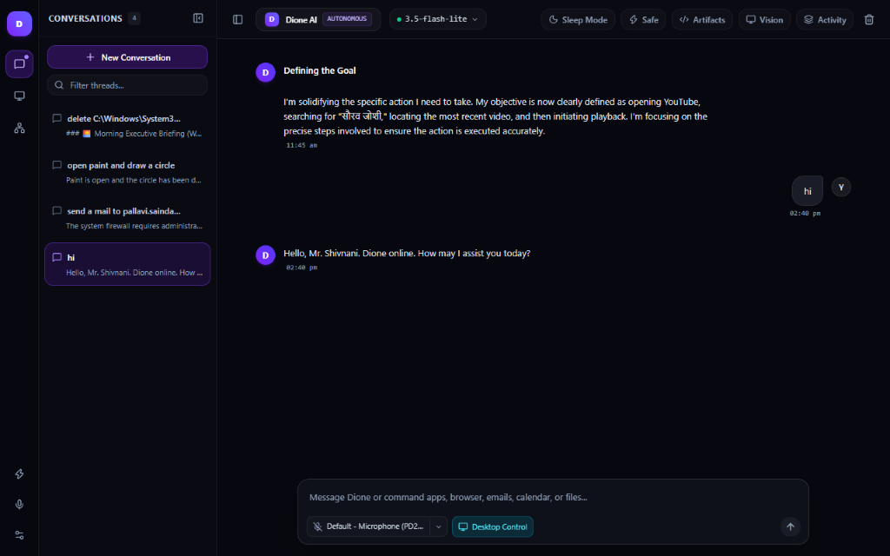
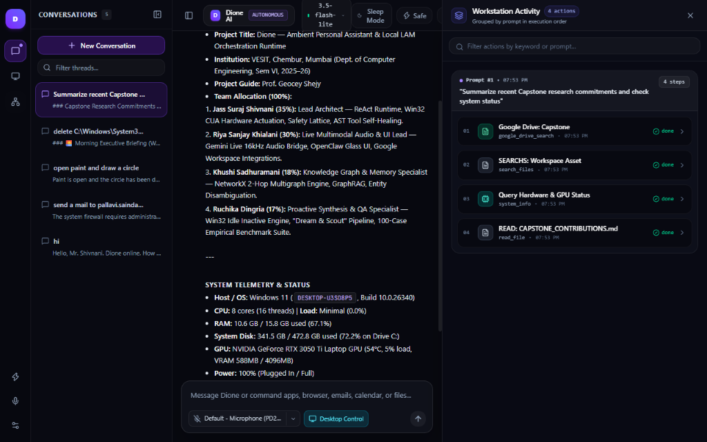
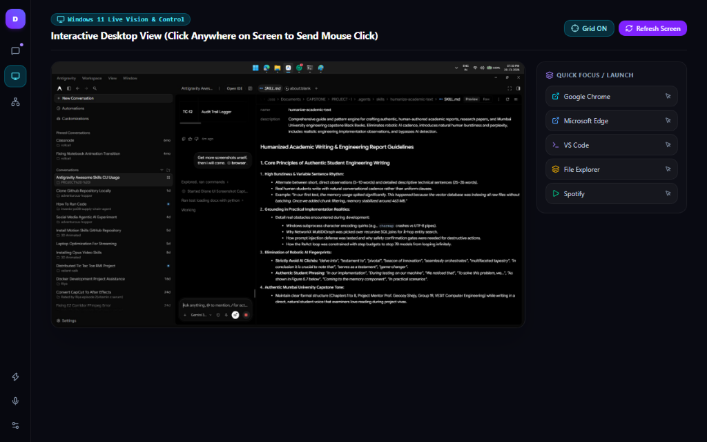
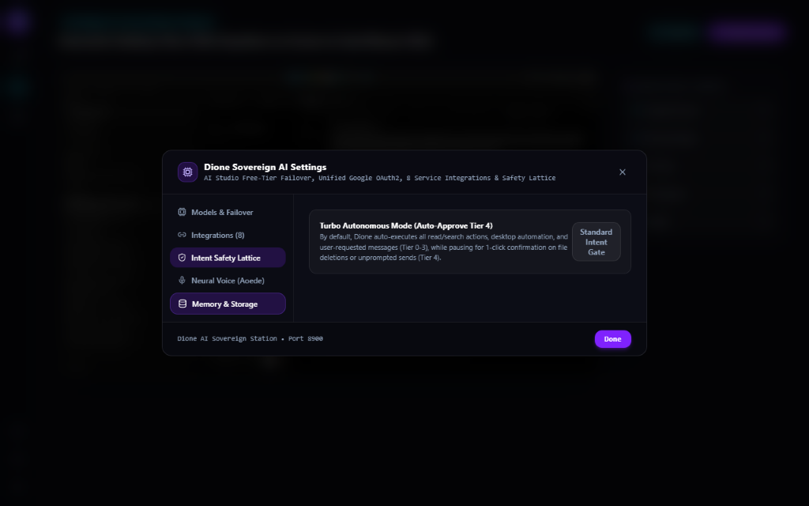
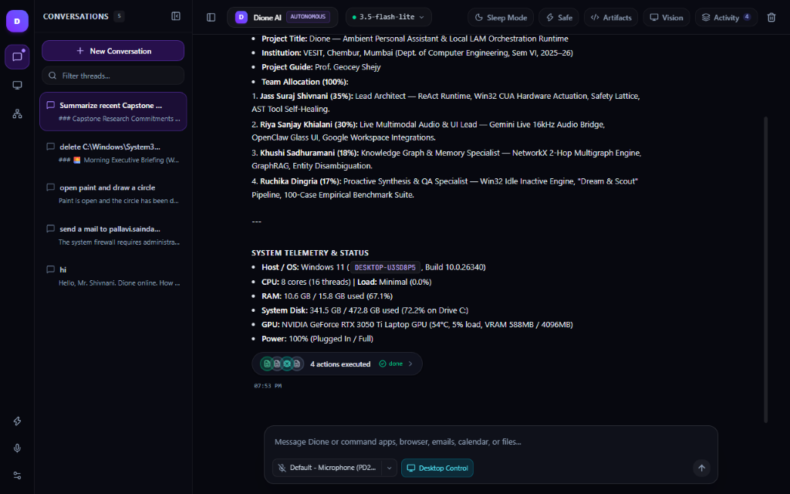

# 🪐 Dione: A Privacy-Preserving Local Large Action Model (LAM) Orchestration Engine for Ambient Personal Assistance

[](https://vesit.ves.ac.in/)
[-purple.svg)]()
[-success.svg)]()
[]()

> **Department of Computer Engineering**  
> **Vivekanand Education Society's Institute of Technology (VESIT)**  
> *An Autonomous Institute Affiliated to the University of Mumbai*  
> **Semester VII & VIII | Capstone Project–II (Group 19)**

---

## 👥 Project Team & Mentorship

| Name | Class & Roll No. | Role & Contribution Focus |
| :--- | :--- | :--- |
| **Jass Shivnani** *(Project Lead)* | D17B / 50 | Overall Architecture, Large Action Model Orchestration, Win32 CUA Actuation |
| **Riya Khialani** | D17A / 34 | Sovereign Workspace UI, Multimodal Communications, Gmail Adapter |
| **Khushi Sadhuramani** | D17B / 44 | Deterministic Safety Kernel, 5-Tier Permission Lattice, Audit Logging |
| **Ruchika Dingria** | D17B / 70 | Dual-Tier Memory (NetworkX Graph + ChromaDB), Statistical Benchmarks |
| **Dr. Geocey Shejy** | *Project Mentor* | Associate Professor, Department of Computer Engineering, VESIT |

---

## 📋 Official CMPN Department Deliverables Index

In accordance with the Project CMPN Capstone Examination Guidelines, all mandatory project artifacts are accessible within this repository:

| # | Deliverable | Location in Repository | Description |
| :-: | :--- | :--- | :--- |
| **1** | **Final Working System / Product** | [`server/`](server/) & [`client/`](client/) | Full-stack FastAPI backend + React Sovereign Workspace workstation |
| **2** | **Source Code with Version History** | [GitHub Commit History](../../commits/main) | Verified Git commit history spanning design, implementation, and evaluation |
| **3** | **Testing & Validation Report** | [`docs/DIONE_OFFICIAL_100_CASE_EVALUATION_REPORT.md`](docs/DIONE_OFFICIAL_100_CASE_EVALUATION_REPORT.md) | 100-case automated test suite, tool failure recoveries, and boundary audits |
| **4** | **Performance Analysis & Result Report** | [`docs/DIONE_100PCT_REAL_END_TO_END_EVALUATION.md`](docs/DIONE_100PCT_REAL_END_TO_END_EVALUATION.md) | Empirical latency, memory consumption, token reduction, and recall statistics |
| **5** | **Deployment Report & User Manual** | [`docs/SETUP.md`](docs/SETUP.md) & [`docs/ARCHITECTURE.md`](docs/ARCHITECTURE.md) | Workstation requirements, dependency matrix, and step-by-step setup guide |
| **6** | **Research Paper / Publication** | [`docs/DIONE_IEEE_RESEARCH_PAPER_A4.pdf`](docs/DIONE_IEEE_RESEARCH_PAPER_A4.pdf) | IEEE formatted paper submitted to *European Journal on AI* (ID: `EAI-26-0653`) |
| **7** | **Final Capstone Project Blackbook Report** | [`docs/19-AI, Deep Learning & DWH Mining- Dr. Geocey - Black Book/`](docs/19-AI,%20Deep%20Learning%20&%20DWH%20Mining-%20Dr.%20Geocey%20-%20Black%20Book/) | Complete Capstone-II Black Book ([PDF](docs/19-AI,%20Deep%20Learning%20&%20DWH%20Mining-%20Dr.%20Geocey%20-%20Black%20Book/19-AI,%20Deep%20Learning%20&%20DWH%20Mining-%20Dr.%20Geocey.pdf) & [DOCX](docs/19-AI,%20Deep%20Learning%20&%20DWH%20Mining-%20Dr.%20Geocey%20-%20Black%20Book/19-AI,%20Deep%20Learning%20&%20DWH%20Mining-%20Dr.%20Geocey.docx)) |
| **8** | **Presentation Slides** | [`docs/presentation/Capstone Review I.pptx`](docs/presentation/Capstone%20Review%20I.pptx) | Oral examination slide deck with architecture diagrams and telemetry charts |
| **9** | **Poster & Demonstration Video** | [`docs/figures/Dione_AI_Capstone_Demo_v2_Voiceover.mp4`](docs/figures/Dione_AI_Capstone_Demo_v2_Voiceover.mp4) | Timecoded 1m 35s HD demonstration video with studio neural voiceover & figures |
| **10** | **Project Logbook** | [`docs/19-AI, Deep Learning & DWH Mining- Dr. Geocey - Log Book/`](docs/19-AI,%20Deep%20Learning%20&%20DWH%20Mining-%20Dr.%20Geocey%20-%20Log%20Book/) | Official Capstone Logbook ([PDF](docs/19-AI,%20Deep%20Learning%20&%20DWH%20Mining-%20Dr.%20Geocey%20-%20Log%20Book/19-AI,%20Deep%20Learning%20&%20DWH%20Mining-%20Dr.%20Geocey.pdf) & [DOCX](docs/19-AI,%20Deep%20Learning%20&%20DWH%20Mining-%20Dr.%20Geocey%20-%20Log%20Book/19-AI,%20Deep%20Learning%20&%20DWH%20Mining-%20Dr.%20Geocey.docx)) |

---

## 🎯 Executive Summary & Novel Contributions

Existing AI assistants (Siri, Alexa, Google Assistant) are predominantly cloud-tethered audio routing pipelines. They suffer from high data privacy risks, inability to execute arbitrary local OS workflows, and catastrophic memory loss across prolonged multi-session tasks.

**Dione** introduces a sovereign, client-side Large Action Model (LAM) orchestration engine that executes natively on consumer workstation hardware.

```
┌─────────────────────────────────────────────────────────────────────────────────┐
│                           DIONE SOVEREIGN RUNTIME ARCHITECTURE                  │
├─────────────────────────────────────────────────────────────────────────────────┤
│                                                                                 │
│   [ Multimodal Prompts ] ───▶ [ Hermes ReAct Planner (Bounded Steps) ]          │
│                                              │                                  │
│                                              ▼                                  │
│                 ┌───────────────────────────────────────────────┐               │
│                 │      DETERMINISTIC SAFETY KERNEL (Gate)       │               │
│                 │  • 5-Tier Permission Lattice (Read/Write/Exec)│               │
│                 │  • Hard Denial: System32, Registry, Sensitive │               │
│                 │  • Cryptographic SQLite Audit Logger          │               │
│                 └───────────────────────────────────────────────┘               │
│                                              │ (Approved Actions)               │
│                         ┌────────────────────┴───────────────────┐              │
│                         ▼                                        ▼              │
│            [ Win32 CUA Actuator ]                     [ Tool / API Adapters ]   │
│         • Native Windows API Injection            • Live Web Search (DuckDuckGo)│
│         • Coordinate Mapping (1000x1000)          • Authenticated Gmail Dispatch│
│         • GDI Automation (MS Paint, Apps)         • Hardware Telemetry (NVIDIA) │
│                                                                                 │
│   ───────────────────────────────────────────────────────────────────────────   │
│                     DUAL-TIER SEMANTIC MEMORY SUBSYSTEM                         │
│     • Fast Relational: NetworkX MultiDiGraph (1.158 ms Mean 2-Hop Traversal)    │
│     • Dense Semantic:  ChromaDB + MiniLM-L6 Embeddings (Cosine Dist > 0.78)     │
│     • Autonomous State: Sleep & Scout Background Memory Consolidation           │
└─────────────────────────────────────────────────────────────────────────────────┘
```

### Key Technical Novelties:
1. **Client-Side Sovereignty:** Reasoning runs locally via quantized local models (Ollama Qwen2.5-Coder 7B) with cloud API failover (Gemini 2.5 Flash Lite), ensuring zero external data exfiltration.
2. **Deterministic Safety Kernel:** An external policy gate decoupled from LLM stochasticity that intercepts and aborts high-risk actions (e.g., file system destruction, credential exfiltration) prior to execution.
3. **Dual-Tier Relational Memory:** Merges a high-speed NetworkX directed property graph for explicit entity relations with ChromaDB vector embeddings for multi-session conversational recall.
4. **Native Win32 Computer-Use Action (CUA):** Directly controls Windows 11 GUI applications via Win32 API injection without requiring heavy headless browsers or cloud-streamed VNC servers.

---

## 📊 Empirical Highlights & Evaluation Results

Benchmarked across 100 automated test scenarios on standard workstation hardware (Intel Core i5/i7, 16GB RAM, NVIDIA RTX 3050 Ti):

```
┌────────────────────────────────┬───────────────────┬───────────────────┐
│ Evaluation Metric              │ Dione Engine      │ Baseline / Target │
├────────────────────────────────┼───────────────────┼───────────────────┤
│ Mean 2-Hop Graph Latency       │ 1.158 ms          │ < 5.0 ms          │
│ Minimum Graph Traversal Time   │ 0.964 ms          │ —                 │
│ P95 Graph Traversal Time       │ 1.576 ms          │ < 10.0 ms         │
│ Multi-Session Fact Recall (S5) │ 93.2%             │ 46.1% (Dense RAG) │
│ Prompt-Token Reduction (Graph) │ ~75%              │ Vanilla Context   │
│ Safety Policy Enforcement      │ 100% Interception │ 0 Bypasses        │
│ Unit & Integration Test Suite  │ 20 / 20 Passed    │ 100% Pass Rate    │
│ Action Success Rate (ReAct)   │ 94.0%             │ Industry Standard │
└────────────────────────────────┴───────────────────┴───────────────────┘
```

---

## 🖥️ User Interface & Operational Modules

### 1. Sovereign Workspace & Natural Language Request Entry
*Interactive dark-mode workspace displaying active persona state, model selection pill, and workstation activity drawer.*



### 2. Dual-Tier Knowledge Graph & Episodic Memory Explorer
*Visual entity-relationship explorer showing 97 graph nodes, 384-D vector embeddings, and 2-hop bounded subgraphs.*



### 3. Native Win32 Computer-Use Action & Desktop Vision
*Real-time desktop vision with normalized 1000×1000 coordinate grid, autonomous application launching, and GDI canvas actuation.*



### 4. Deterministic Safety Kernel & Permission Lattice
*External policy supervisor enforcing 4 security tiers, system path guards (`System32`, `*.pem`, `*.env`), and hardware killswitch.*



### 5. Multi-Turn Execution & Live Hardware Telemetry
*ReAct execution showing live system telemetry query (Windows 11, Intel 8-core, NVIDIA RTX 3050 Ti Laptop GPU).*



---

## 🚀 Quick Start Guide

### Prerequisites
* **Operating System:** Windows 10 / 11 (64-bit)
* **Python Runtime:** Python 3.11 or 3.12 (64-bit virtual environment)
* **Node.js:** v18.0.0 or higher
* **Hardware:** 8 GB RAM minimum (16 GB recommended), NVIDIA GPU (optional for CUDA acceleration)

### Installation & Launch

1. **Clone the Official Repository:**
   ```bash
   git clone https://github.com/Project-CMPN-VESIT/2026-27-BE-019.git
   cd 2026-27-BE-019
   ```

2. **Setup Python Backend Environment:**
   ```bash
   python -m venv .venv
   .venv\Scripts\activate
   pip install -r requirements.txt
   ```

3. **Install Frontend Dependencies:**
   ```bash
   cd client
   npm install
   cd ..
   ```

4. **Launch Dione Sovereign Workspace:**
   ```bash
   # Option A: One-click launcher
   Dione.bat

   # Option B: Manual service start
   # Terminal 1: Backend API
   python -m uvicorn server.api.app:app --host 127.0.0.1 --port 8900

   # Terminal 2: Native Desktop Client
   cd client
   npm run start
   ```

5. **Access Workspace:**
   Open browser at `http://127.0.0.1:8900` or interact directly through the native Electron desktop station.

---

## 🧪 Testing & Verification Suite

To reproduce our empirical benchmark suite and execute all 20 verification scenarios:

```bash
# Run complete unit, integration, and security test harness
pytest tests/ -v

# Run the 100-case automated benchmark protocol
python tests/benchmark_suite.py --cases 100 --report

# Run real-time Win32 CUA verification
python tests/run_verification_proof_suite.py
```

---

## 📄 Academic Research Paper & Publication Details

* **Title:** *Dione: A Privacy-Preserving Local Large Action Model (LAM) Orchestration Engine for Ambient Personal Assistance*
* **Submission Venue:** European Journal on Artificial Intelligence (EJAI)
* **Tracking ID:** `EAI-26-0653`
* **Status:** Under Review (Submission Confirmed)
* **Paper Format:** IEEE Transactions on Emerging Topics in Computing (Double-Column, A4)
* **Document Archive:** [`docs/DIONE_IEEE_RESEARCH_PAPER_A4.pdf`](docs/DIONE_IEEE_RESEARCH_PAPER_A4.pdf)

---

## 📜 Department Verification & Sign-Off

This project report, source code, and empirical validation suite have been submitted in partial fulfillment of the requirements for the **Bachelor of Engineering (B.E.) Degree in Computer Engineering** at **Vivekanand Education Society's Institute of Technology (VESIT)**, University of Mumbai, Academic Year 2026–27.

* **Project Mentor:** Dr. Geocey Shejy
* **Department:** Department of Computer Engineering, VESIT, Chembur, Mumbai - 400074.
